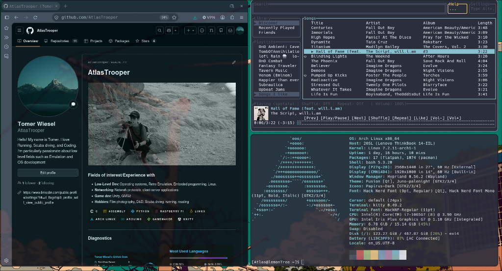
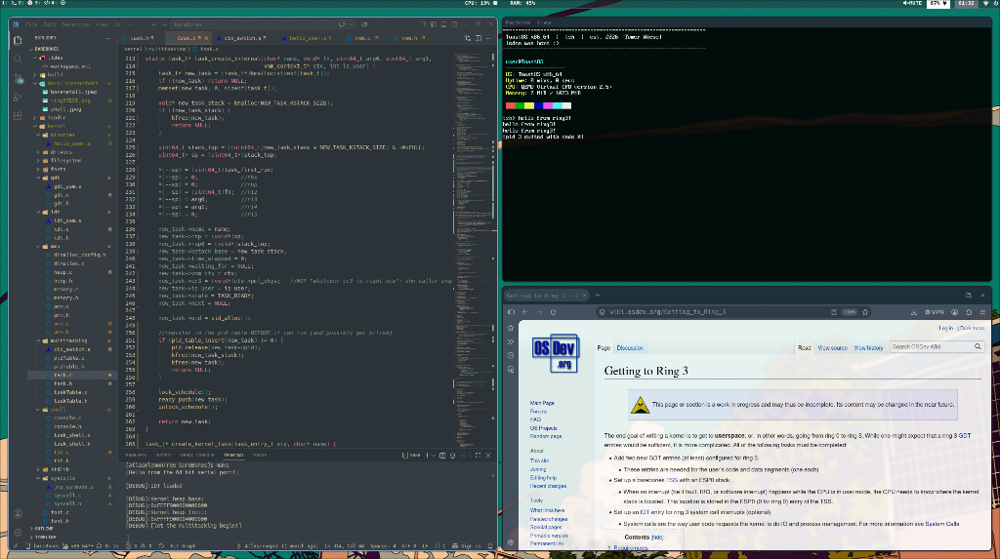

# Welcome to my dotfiles
It's been about a year since I started daily driving arch and it's got be one of the best workflow decisions I've ever made.
While my time for customizing and tinkering has gone down drastically since starting university, I do play around with the system every once in a while. I figured the repo was long overdue for an update so without further adu, here it is!

## System Specifications and Utilities

### Desktop Environment & Core Interface
* **Window Manager:** Hyprland
* **Status Bar:** Waybar (minimal, custom layout)
* **Terminal Emulator:** Kitty
* **Application Launcher:** Rofi
* **Interface Theming:** Juno Palenight (GTK theme via nwg-look/custom settings) with Papirus-Dark icons. Qt applications matched using qt6ct/Kvantum.

### File & System Management
* **File Manager:** Thunar (with tumbler thumbnail support and thunar-volman)
* **Storage & Device Mounts:** udiskie for automated media mounting
* **System Monitors & Diagnostics:** Gnome System Monitor, ncdu, and Wireshark
* **Network & Power:** NetworkManager (with nm-applet) and power-profiles-daemon

### Environment Control
* **Wallpaper Daemon:** Hyprpaper
* **Idle Management:** Hypridle
* **Screen Locker:** Hyprlock
* **Brightness Control:** brightnessctl

### Media, Audio & Notifications
* **Audio Visualizer:** Cava
* **Music Infrastructure:** Music Player Daemon (MPD) paired with mpc and the rmpc terminal client
* **Music Streaming:** Spotify (managed via spotify-launcher and customized via Spicetify themes)
* **Audio Server Control:** PipeWire (with PulseAudio and ALSA emulation layers), mixed via pavucontrol
* **Screen Capture:** Hyprshot
* **Notification Stack:** SwayNC backed by notify-send

### Development Environments & Toolchains
* **Text Editors & IDEs:** Custom terminal-focused Neovim setups, Visual Studio Code (code-oss), and the Arduino IDE for embedded microcontroller development.
* **Low-Level Tooling & Compilation:** GCC/Clang development suites (base-devel, bear), NASM assembler, and Valgrind debug engines.
* **Emulation & Virtualization:** QEMU (base/desktop architectures) along with Bochs (integrated with GDB support) for operating system testing and kernel debugging.
* **Version Control:** Git supplemented by the lazygit terminal interface.

## Gallery

# Tips and recommendations are always appreciated.

